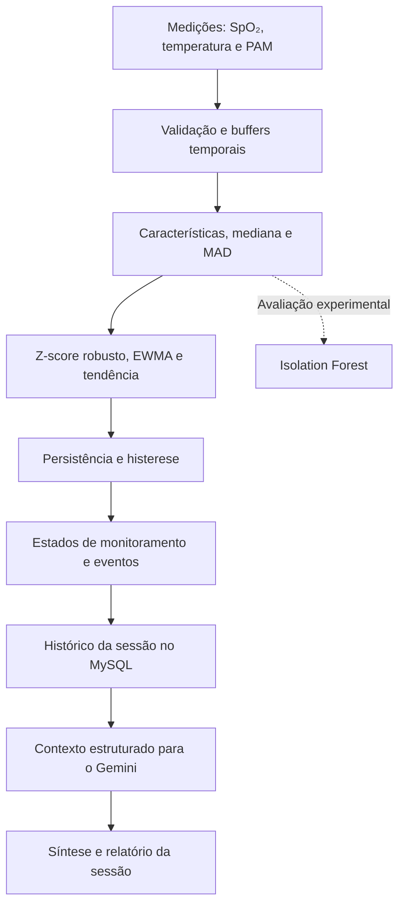

🐾 M.I.S.A.
Monitor Inteligente de Saúde Animal
Aplicação desktop para acompanhamento de sinais vitais de pacientes veterinários, registro clínico e apoio à identificação de alterações durante o monitoramento.

Python · PySide6 · MySQL · Análise temporal · Google Gemini

Projeto acadêmico de Engenharia da Computação — FHO

📌 Sobre o projeto
O M.I.S.A. (Monitor Inteligente de Saúde Animal) é uma aplicação executada localmente, desenvolvida para auxiliar estudantes e docentes de Medicina Veterinária no acompanhamento de animais sedados ou hospitalizados em clínicas universitárias.

A plataforma reúne dados do paciente, visualização de sinais vitais, histórico de medicações e procedimentos e alertas gerados por algoritmos de análise temporal. Ao final de uma sessão de monitoramento, as informações podem ser organizadas em um relatório com apoio do Google Gemini.

O propósito é facilitar a observação da evolução do paciente, apoiar o aprendizado prático dos alunos e fornecer ao docente um histórico organizado para acompanhamento. O M.I.S.A. é uma ferramenta de apoio: não realiza diagnóstico veterinário e não substitui a avaliação de um profissional.
Contexto acadêmico
Informação	Descrição
Instituição	FHO
Curso	Engenharia da Computação
Período	8º período
Disciplina	Aplicações Integradas em Engenharia da Computação
Orientador	Prof. Thiago Milani
Tipo de projeto	Aplicação desktop / projeto acadêmico

🎯 Objetivos
- Acompanhar continuamente SpO₂ (%), temperatura corporal (°C) e pressão arterial média — PAM (mmHg).
- Apresentar os sinais vitais em gráficos e indicadores atualizados durante o monitoramento.
- Identificar mudanças persistentes em relação ao comportamento recente de cada paciente.
- Registrar, por sessão, eventos de monitoramento, procedimentos, medicações e observações do docente.
- Distinguir o acesso de docentes (administradores) e alunos (usuários).
- Auxiliar na documentação do acompanhamento por meio de relatórios e sínteses geradas com IA.
- Permitir uma arquitetura de aquisição extensível a diferentes fontes de dados.
⚙️ Funcionalidades
Módulo	Descrição
Autenticação	Login de alunos por RA e senha e de docentes por e-mail e senha.
Cadastro de usuários	Criação de contas com identificação e tipo de acesso.
Cadastro de animais	Registro da identificação, espécie, idade, porte, responsável e informações clínicas iniciais.
Monitoramento	Exibição de SpO₂, temperatura e PAM, incluindo gráficos de evolução temporal.
Análise de sinais	Avaliação individual dos parâmetros com referência estatística recente, tendência e critérios de persistência.
Alertas de saúde	Estados de normalidade, observação, alerta e recuperação, com explicações das alterações detectadas.
Histórico clínico	Registro de medicações, quantidades, procedimentos, responsáveis, data, hora e observações.
Sessões de acompanhamento	Organização dos dados e eventos do início ao encerramento de cada monitoramento.
Relatórios	Consolidação dos dados da sessão, gráficos, histórico e sínteses textuais com Google Gemini.
Exportação	Opção de download de relatórios em PDF.

Perfis e permissões
Recurso	Aluno — User	Docente — Admin
Visualizar pacientes e monitoramento	✅	✅
Consultar alertas e histórico	✅	✅
Cadastrar procedimentos e medicações	✅	✅
Baixar relatórios e arquivos	✅	✅
Cadastrar novos animais	—	✅
Iniciar e gerenciar a entrada de dados do monitoramento	—	✅
Registrar observações docentes	—	✅

🧠 Como funciona a análise dos sinais vitais
O M.I.S.A. não depende apenas de limites fixos de sinais vitais. Seu mecanismo principal compara cada nova medição com o histórico recente do próprio paciente, para reconhecer desvios e tendências ao longo do tempo.

De forma resumida, o processamento segue estas etapas:
1. Recepção e validação: recebe uma medição, identifica o parâmetro e verifica a qualidade dos dados.
2. Janela temporal: armazena as leituras recentes em buffers e extrai características da série.
3. Referência individual: calcula uma referência robusta com mediana e MAD (Median Absolute Deviation).
4. Detecção de mudança: utiliza Z-score robusto, EWMA (média móvel exponencialmente ponderada) e análise de tendência.
5. Confirmação temporal: aplica regras de persistência e histerese, reduzindo reações a oscilações isoladas.
6. Estados e eventos: classifica a evolução de cada parâmetro e registra alterações relevantes para a sessão.

Estados de acompanhamento
- Normal: medições compatíveis com o padrão recente.
- Observação: mudança identificada, ainda sem persistência suficiente para confirmar um alerta.
- Alerta: alteração relevante confirmada após leituras consecutivas.
- Recuperação: sinal retornando em direção ao comportamento recente esperado.
O sistema também considera situações de aquecimento (histórico inicial insuficiente) e indisponibilidade (dados insuficientes ou sem qualidade adequada).
Qual é o papel da inteligência artificial?
O projeto utiliza métodos com finalidades diferentes:
- Análise estatística temporal: mediana, MAD, Z-score robusto, EWMA, tendência, persistência e histerese fazem a detecção principal de mudanças.
- Aprendizado de máquina: Isolation Forest é utilizado como abordagem não supervisionada para estudos e comparação experimental com o detector estatístico.
- IA generativa: Google Gemini organiza em texto as informações já calculadas e registradas, como valores dos sinais, eventos, medicações, procedimentos e observações do professor.
O Gemini não decide se um sinal está normal ou em alerta. Essa decisão é realizada anteriormente pelos algoritmos de análise. A geração de relatórios deve descrever os dados disponíveis, sem inventar informações, afirmar causalidade não comprovada ou emitir diagnóstico.
Nota científica: o sistema identifica mudanças temporais e tendências observáveis; ele não prevê numericamente os sinais vitais futuros nem possui validação clínica demonstrada. Os ensaios computacionais podem utilizar dados simulados ou arquivos estruturados.

📡 Aquisição de dados e sessões
A arquitetura foi pensada para receber medições de diferentes origens. Durante o desenvolvimento, simuladores e arquivos estruturados permitem testar o monitoramento e as respostas dos algoritmos. A integração com equipamentos por Wi-Fi, Bluetooth ou outros meios de transmissão faz parte do levantamento e da evolução prevista da coleta de dados.

Cada sessão representa o intervalo entre iniciar e encerrar o monitoramento de um paciente. Nela podem ser relacionados os sinais vitais coletados, os alertas e eventos identificados, os registros clínicos e as observações do docente, formando a base para consulta e emissão do relatório.
🖥️ Telas do sistema
As imagens abaixo ilustram as principais funcionalidades da aplicação. Os pacientes e registros apresentados são exemplos de uso da interface.
1. Acesso e contas
Tela de login
Permite acessar a plataforma como aluno, utilizando RA e senha, ou como docente, utilizando e-mail e senha. O perfil determina quais recursos ficam disponíveis após a autenticação.
Cadastro de usuário
Formulário para criação de contas, com identificação, tipo de acesso e senha. O cadastro distingue os perfis de aluno e docente.
2. Telas iniciais por perfil
Tela inicial — aluno
Apresenta o espaço para visualização do paciente selecionado, indicadores, gráfico de sinais vitais e histórico clínico. Antes da seleção de um paciente, os campos permanecem sem dados.
Tela inicial — docente
Além da visualização dos sinais e do histórico, oferece controles administrativos, como Cadastrar Animal, gerenciamento do monitoramento e campo para observações do docente.
3. Cadastro do paciente
Cadastrar animal
O docente vincula o animal ao aluno responsável e registra informações como nome, espécie, idade, porte, procedimento inicial, estado clínico, última medicação e dose/quantidade.
4. Monitoramento em tempo real
Acompanhamento do animal
Reúne informações do paciente, valores atuais de SpO₂, temperatura e PAM, gráficos de evolução, ações disponíveis, histórico de procedimentos e medicações e painel explicativo dos alertas.
5. Registros no histórico clínico
Cadastrar medicação
Permite informar a medicação, quantidade, unidade, responsável pela aplicação, data e hora. O registro é associado ao histórico do paciente.
Cadastrar procedimento
Registra o procedimento realizado, responsável, data, hora e observações relacionadas. Esses dados compõem o histórico clínico e podem integrar o relatório da sessão.
6. Estados dos alertas de IA
O painel descreve a condição identificada pelos algoritmos em cada parâmetro. Ele exibe informações como valor atual, referência recente e sentido da mudança, sem substituir a interpretação clínica.
Monitoramento estável — Normal
Indica que nenhuma alteração persistente foi identificada pelos critérios do monitoramento. Exibe os sinais atuais e o acompanhamento contínuo.
Alteração em observação — Observação
Sinaliza uma mudança em relação ao padrão recente, ainda em acompanhamento para verificar se o comportamento persiste.
Alerta ativo — Alerta
Destaca uma alteração persistente confirmada, apresentando o parâmetro afetado, a medição atual e sua comparação com a referência recente.
Sinal em recuperação — Recuperação
Mostra que o parâmetro está retornando em direção ao comportamento recente, enquanto o sistema continua verificando novas medições.
🛠️ Tecnologias e bibliotecas
Camada	Ferramentas
Linguagem e lógica de negócio	Python
Aplicação desktop e interface	PySide6 (Qt for Python)
Persistência de dados	MySQL e conectores Python
Manipulação numérica e dados	NumPy, pandas, SciPy
Aprendizado de máquina e avaliação	scikit-learn (incluindo Isolation Forest)
IA generativa	Google Gemini por meio de google-genai
Configuração e validação	python-dotenv, pydantic
Autenticação e senhas	bcrypt
Testes	pytest, pytest-qt
Desenvolvimento	Ambiente local de desenvolvimento Python

As bibliotecas e versões informadas para o projeto estão no arquivo [`requirements.txt`](requirements.txt) deste pacote.
🚀 Preparação do ambiente de desenvolvimento
As instruções abaixo preparam as dependências. A configuração do banco e o comando de inicialização dependem da organização do código-fonte da aplicação.

1. Obtenha o código-fonte do projeto e abra sua pasta no terminal.
2. Crie e ative um ambiente virtual Python (exemplo no Windows):
   py -m venv .venv
   .\.venv\Scripts\Activate.ps1
3. Instale as dependências:
   python -m pip install -r requirements.txt
4. Configure o MySQL, as credenciais e as variáveis de ambiente utilizadas pela aplicação. Para recursos com Gemini, configure também o acesso à API correspondente. Não publique senhas, credenciais nem chaves de API no repositório.
5. Inicie a aplicação a partir do arquivo de entrada definido no código-fonte.
🗂️ Organização dos arquivos de documentação
MISA_GitHub/
├── README.md
├── requirements.txt
└── assets/
    └── screenshots/
        ├── tela_login.png
        ├── tela_cadastro.png
        ├── tela_inicial.png
        ├── tela_inicial_professor.png
        ├── cadastrar_animal.png
        ├── cadastrar_medicacao.png
        ├── cadastrar_procedimento.png
        ├── monitoramento_animal.png
        ├── monitoramento_animal_estavel.png
        ├── monitoramento_animal_observacao.png
        ├── monitoramento_animal_alerta.png
        └── monitoramento_animal_recuperacao.png
Ao incorporar esta documentação ao repositório, mantenha a pasta assets/screenshots/ no mesmo caminho relativo indicado nas imagens acima para que elas sejam exibidas corretamente pelo GitHub.
👨‍💻 Desenvolvedores
Integrante	GitHub
Bryan J. Martini	@Bryan-J-Martini
Thayná Adrielly	@Tags2005
Pedro Mantovani	@Vallkari
Daniel Remédio	@DanRelief

Orientação: Prof. Thiago Milani · FHO — Engenharia da Computação.
📚 Escopo acadêmico e considerações
O projeto investiga a aplicação de estatística temporal, aprendizado de máquina e IA generativa em um sistema de acompanhamento de saúde animal. A comparação experimental entre o detector estatístico e o Isolation Forest considera métricas como precisão, recall, F1-score, matriz de confusão e tempo de processamento.

Os algoritmos apoiam a identificação de mudanças nas séries monitoradas e o registro de evidências. Os resultados iniciais de simulação não constituem validação clínica, e a interpretação do estado de saúde do animal deve permanecer sob responsabilidade de profissionais habilitados.

M.I.S.A. — Tecnologia e educação no apoio ao cuidado veterinário.

