<div align="center">

# M.I.S.A.
## Monitor Inteligente de Saúde Animal

**Sistema desktop para monitoramento de sinais vitais, gerenciamento de pacientes veterinários e identificação de alterações por meio de análise temporal e Inteligência Artificial.**

**Python | PySide6 | MySQL | Scikit-learn | Google Gemini**

**Engenharia da Computação — FHO**

</div>

---

## 1. Sobre o Projeto

O **M.I.S.A. (Monitor Inteligente de Saúde Animal)** é uma aplicação desktop desenvolvida para auxiliar alunos e professores de Medicina Veterinária no acompanhamento de animais sedados ou hospitalizados em clínicas universitárias.

O sistema permite acompanhar sinais vitais em tempo real, registrar informações clínicas, identificar alterações no comportamento fisiológico do paciente e gerar relatórios com auxílio de Inteligência Artificial.

### Informações Acadêmicas

| Informação | Descrição |
|:---|:---|
| **Instituição** | Fundação Hermínio Ometto (FHO) |
| **Curso** | Engenharia da Computação |
| **Período** | 8º semestre |
| **Disciplina** | Aplicações Integradas em Engenharia da Computação |
| **Professor Orientador** | Prof. Thiago Milani |
| **Plataforma** | Aplicação desktop de execução local |

### Desenvolvedores

| Integrante | GitHub |
|:---|:---|
| **Bryan J. Martini** | [Bryan-J-Martini](https://github.com/Bryan-J-Martini) |
| **Thayná Adrielly** | [Tags2005](https://github.com/Tags2005) |
| **Pedro Mantovani** | [Vallkari](https://github.com/Vallkari) |
| **Daniel Remédio** | [DanRelief](https://github.com/DanRelief) |

---

## 2. Objetivos do Sistema

O objetivo principal do M.I.S.A. é oferecer uma ferramenta de apoio ao monitoramento veterinário, permitindo acompanhar a evolução clínica de pacientes e identificar mudanças relevantes em seus sinais vitais.

### Principais funcionalidades

- **Monitoramento em tempo real:** acompanhamento contínuo de SpO₂, temperatura corporal e pressão arterial média.
- **Análise inteligente:** identificação de alterações temporais por meio de algoritmos estatísticos e técnicas de aprendizado de máquina.
- **Gerenciamento de pacientes:** cadastro de animais e organização de suas informações clínicas.
- **Histórico clínico:** registro de medicações, procedimentos, responsáveis e observações.
- **Alertas automatizados:** identificação de mudanças persistentes e acompanhamento da recuperação.
- **Relatórios inteligentes:** geração de documentos com gráficos, histórico e análises textuais com Google Gemini.
- **Controle de acesso:** diferentes permissões para alunos e professores.

### Parâmetros monitorados

| Parâmetro | Unidade | Descrição |
|:---|:---:|:---|
| **SpO₂** | % | Saturação periférica de oxigênio |
| **Temperatura** | °C | Temperatura corporal do paciente |
| **PAM** | mmHg | Pressão arterial média |

---

## 3. Controle de Acesso e Permissões

O sistema possui autenticação de usuários com dois níveis de acesso, definidos conforme o perfil cadastrado.

| Funcionalidade | Aluno (User) | Docente (Admin) |
|:---|:---:|:---:|
| Visualizar pacientes | Sim | Sim |
| Acompanhar sinais vitais | Sim | Sim |
| Consultar alertas | Sim | Sim |
| Registrar procedimentos | Sim | Sim |
| Registrar medicações | Sim | Sim |
| Consultar e baixar relatórios | Sim | Sim |
| Cadastrar animais | Não | Sim |
| Gerenciar entrada de dados | Não | Sim |
| Registrar observações docentes | Não | Sim |

**Autenticação:**
- **Alunos:** acesso por RA e senha.
- **Docentes:** acesso por e-mail e senha.

---

## 4. Tecnologias Utilizadas

| Tecnologia | Aplicação no Projeto |
|:---|:---|
| **Python** | Desenvolvimento da lógica e processamento dos dados |
| **PySide6** | Construção da interface gráfica desktop |
| **MySQL** | Armazenamento de usuários, pacientes, medições e registros clínicos |
| **NumPy e Pandas** | Manipulação e análise dos sinais vitais |
| **SciPy** | Ferramentas de processamento e análise estatística |
| **Scikit-learn** | Aprendizado de máquina e avaliação dos algoritmos |
| **Google Gemini** | Geração de análises textuais para os relatórios |
| **Bcrypt** | Proteção de senhas dos usuários |
| **Pytest** | Testes automatizados dos componentes |

As demais dependências e suas versões estão disponíveis no arquivo `requirements.txt`.

---

## 5. Monitoramento e Inteligência Artificial

O M.I.S.A. utiliza uma abordagem de **análise temporal individualizada**, comparando novas medições com o comportamento recente do próprio paciente.

Diferentemente de uma análise baseada apenas em limites fixos, os algoritmos consideram o histórico das medições, a intensidade dos desvios e a persistência das alterações.

### 5.1. Processamento dos Sinais Vitais

O fluxo principal de análise é composto pelas seguintes etapas:

1. **Aquisição:** recebimento e validação das medições.
2. **Buffer temporal:** armazenamento das leituras recentes.
3. **Baseline:** construção de uma referência estatística utilizando mediana e MAD.
4. **Detecção:** cálculo do Z-score robusto para identificar desvios.
5. **Análise temporal:** utilização de EWMA e tendência para acompanhar a evolução do sinal.
6. **Persistência e histerese:** confirmação de alterações e controle das transições entre estados.
7. **Registro:** armazenamento dos alertas e eventos da sessão no banco de dados.

### 5.2. Estados do Monitoramento

| Estado | Descrição |
|:---|:---|
| **NORMAL** | Comportamento compatível com a referência recente do paciente. |
| **OBSERVAÇÃO** | Alteração identificada, aguardando confirmação de persistência. |
| **ALERTA** | Alteração relevante confirmada após medições consecutivas. |
| **RECUPERAÇÃO** | Parâmetro retornando em direção ao comportamento recente esperado. |

O sistema também considera períodos de aquecimento, quando ainda não existem medições suficientes, e situações de indisponibilidade dos dados.

### 5.3. Aprendizado de Máquina

Além do detector estatístico principal, o projeto utiliza o algoritmo **Isolation Forest**, baseado em aprendizado de máquina não supervisionado.

Sua utilização permite comparar diferentes abordagens de detecção de anomalias, considerando indicadores como precisão, recall, F1-score e tempo de processamento.

### 5.4. Integração com Google Gemini

O **Google Gemini** é utilizado para organizar e apresentar informações relevantes das sessões de monitoramento em relatórios textuais.

Os relatórios podem reunir:

- Dados do paciente e informações da sessão.
- Gráficos e evolução dos sinais vitais.
- Alertas e eventos registrados.
- Medicações e procedimentos realizados.
- Observações e orientações do professor.
- Resumo das análises produzidas pelos algoritmos.

**Importante:** a identificação de alterações é realizada pelos algoritmos de monitoramento. O Gemini atua na organização e interpretação textual dos resultados, não sendo responsável por realizar diagnósticos veterinários.

---

## 6. Interfaces do Sistema

As interfaces foram desenvolvidas utilizando **Python e PySide6**, com apresentação visual adaptada ao perfil de acesso do usuário.

### 6.1. Tela de Login

Responsável pela autenticação dos usuários. O acesso é realizado por RA ou e-mail, conforme o perfil selecionado, juntamente com a senha cadastrada.

<p align="center">
  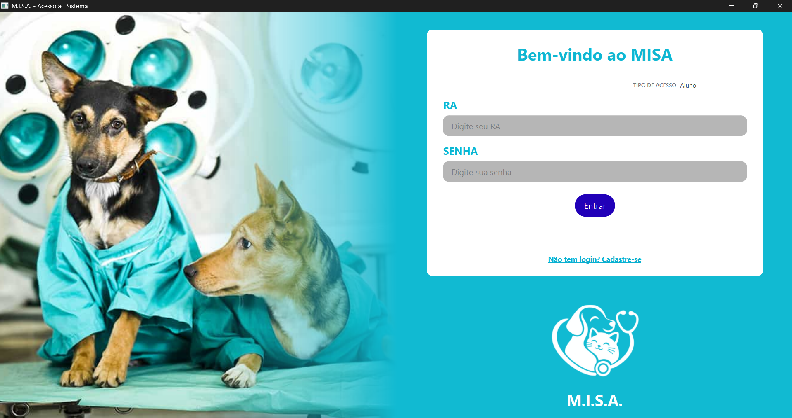
</p>

<br>

### 6.2. Cadastro de Usuários

Permite a criação de contas para alunos e docentes, registrando as informações de identificação, credenciais e tipo de acesso.

<p align="center">
  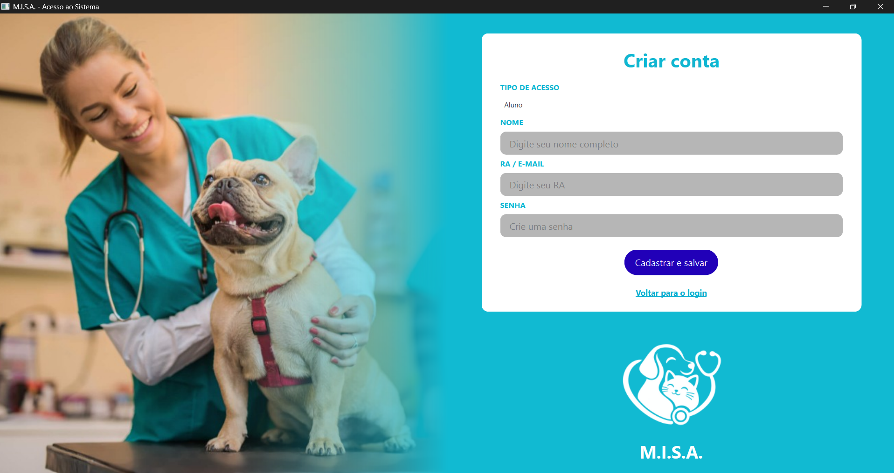
</p>

<br>

### 6.3. Tela Inicial — Aluno

Apresenta os dados do paciente, gráficos de monitoramento, histórico clínico e alertas.

O aluno possui acesso às funcionalidades de acompanhamento, registro de medicações e procedimentos e consulta de relatórios.

<p align="center">
  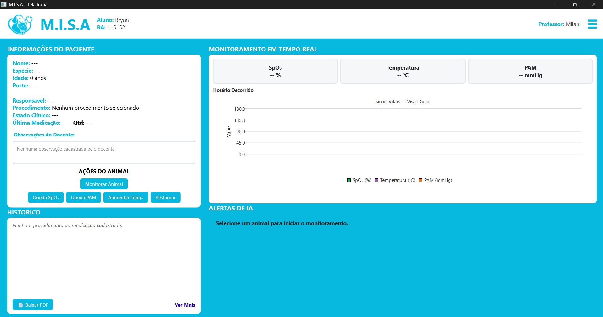
</p>

<br>

### 6.4. Tela Inicial — Docente

Disponibiliza os recursos administrativos do sistema, permitindo cadastrar pacientes, iniciar o monitoramento, gerenciar a entrada de dados e registrar observações clínicas.

<p align="center">
  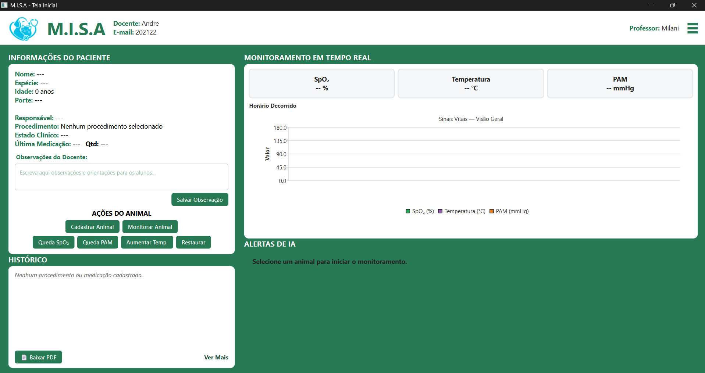
</p>

<br>

### 6.5. Cadastro de Animais

Interface exclusiva do docente, utilizada para registrar pacientes veterinários.

Permite informar nome, espécie, idade, porte, aluno responsável, procedimento inicial, estado clínico e informações sobre medicações.

<p align="center">
  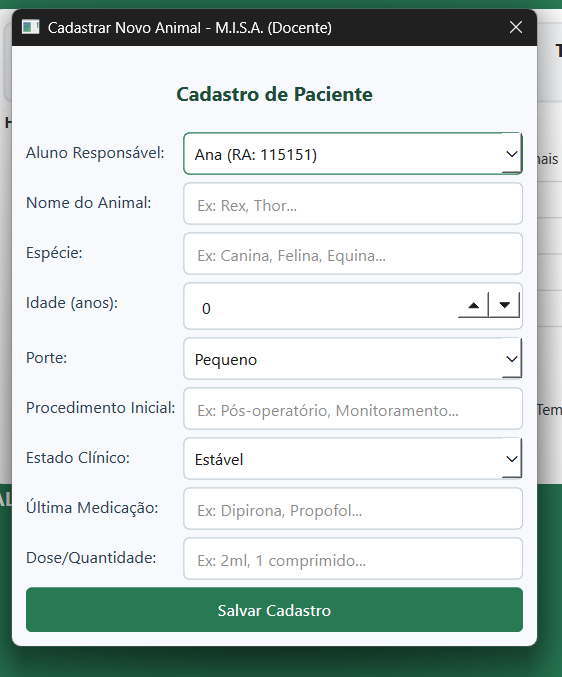
</p>

<br>

### 6.6. Monitoramento do Paciente

Tela principal de acompanhamento clínico, reunindo informações do animal, indicadores de sinais vitais, gráficos de evolução temporal, histórico de procedimentos e painel de alertas.

<p align="center">
  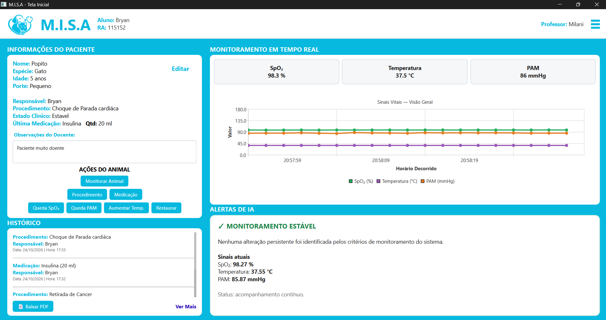
</p>

<br>

### 6.7. Cadastro de Medicações

Permite registrar a medicação administrada, quantidade, unidade de medida, responsável pela aplicação, data e horário.

Os registros ficam associados ao histórico do paciente.

<p align="center">
  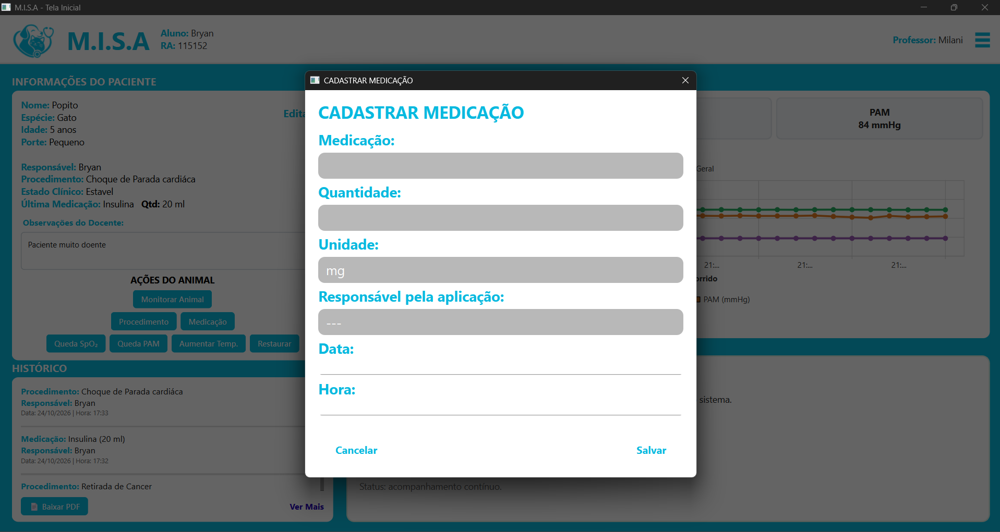
</p>

<br>

### 6.8. Cadastro de Procedimentos

Permite documentar procedimentos clínicos realizados durante o acompanhamento, incluindo responsável, data, horário e observações.

<p align="center">
  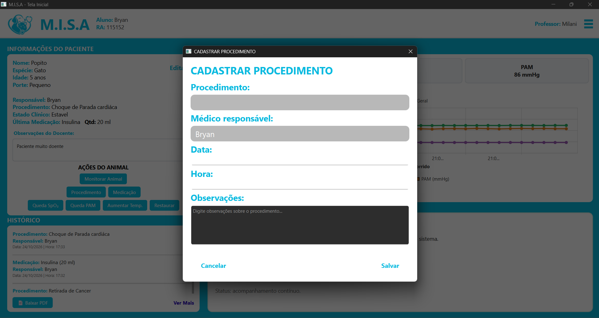
</p>

<br>

---

## 7. Sistema de Alertas

O painel de alertas apresenta os resultados produzidos pelo mecanismo de análise temporal, permitindo acompanhar individualmente a evolução dos sinais vitais.

### 7.1. Monitoramento Estável

Indica que os parâmetros analisados permanecem compatíveis com o comportamento recente, sem identificação de alterações persistentes.

<p align="center">
  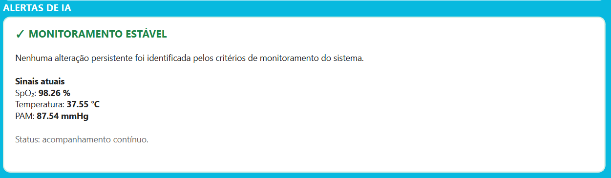
</p>

<br>

### 7.2. Alteração em Observação

Exibido quando uma mudança é identificada, mas ainda não existem evidências temporais suficientes para confirmar um alerta.

<p align="center">
  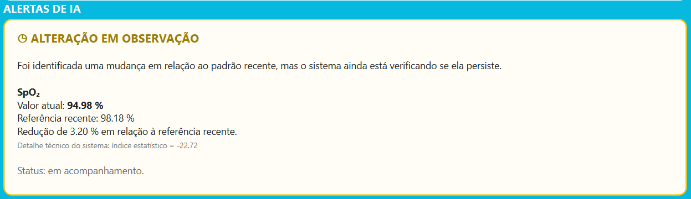
</p>

<br>

### 7.3. Alerta Ativo

Apresentado quando uma alteração persistente é confirmada. O painel destaca o parâmetro afetado, sua medição atual e a referência recente.

<p align="center">
  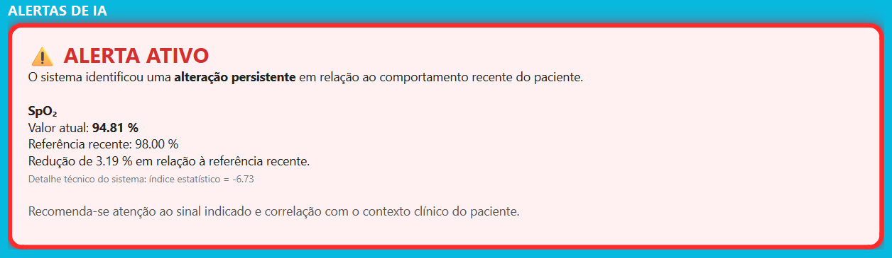
</p>

<br>

### 7.4. Sinal em Recuperação

Indica que o parâmetro anteriormente alterado está retornando em direção à sua referência recente, permanecendo sob acompanhamento.

<p align="center">
  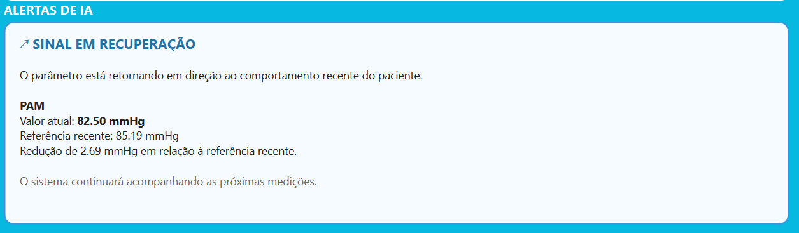
</p>

<br>

---

## 8. Aquisição de Dados e Sessões

O sistema foi desenvolvido com uma arquitetura preparada para receber dados de diferentes fontes.

Durante o desenvolvimento, foram utilizados **dados simulados e arquivos estruturados** para testar o comportamento dos algoritmos de monitoramento.

A integração com equipamentos por **Wi-Fi, Bluetooth ou outros meios de transmissão** faz parte do estudo e da evolução da aquisição de dados.

Cada sessão corresponde ao intervalo entre o início e o encerramento do monitoramento de um paciente.

As sessões permitem organizar:

- Medições e gráficos dos sinais vitais.
- Alterações e eventos identificados.
- Procedimentos e medicações cadastrados.
- Observações do professor.
- Relatórios de acompanhamento.

---

## 9. Instalação e Dependências

O M.I.S.A. foi desenvolvido em Python, com execução local em ambiente desktop.

### Preparação do ambiente

**1. Clonar o repositório**

```bash
git clone <URL_DO_REPOSITORIO>
```

**2. Criar um ambiente virtual**

```bash
python -m venv .venv
```

**3. Ativar o ambiente virtual no Windows**

```powershell
.\.venv\Scripts\Activate.ps1
```

**4. Instalar as dependências**

```bash
pip install -r requirements.txt
```
Para o python recomenda-se qualquer versão acima da 3.11 para instalação das libs e dependências.

**5. Configurar o ambiente**

Configurar a conexão com o MySQL e as variáveis de ambiente necessárias que devem ser configuradas como senha, host, user, do banco de dados, incluindo a chave de acesso à API do Gemini para utilização dos relatórios inteligentes. Um exemplo de como deve ser o .env, está um documento de nome .env_exemplo

A inicialização da aplicação deve ser realizada pelo arquivo principal definido no código-fonte ou via terminal via comando

```bash
python main.py
```
A criação do .exe pode ser feita via comando dentro do ambiente virtual e ficará disponível em dist/MISA:

```bash
python -m PyInstaller --noconfirm --onedir --windowed --add-data "assets;assets" --add-data ".env;." --icon="assets/icone.ico" --name "MISA" main.py
```
---

## 10. Considerações Finais

O **M.I.S.A.** integra monitoramento de sinais vitais, análise estatística temporal, aprendizado de máquina e inteligência artificial generativa em uma única aplicação desktop.

O projeto busca contribuir para a formação acadêmica dos estudantes de Medicina Veterinária, oferecendo ferramentas de acompanhamento, organização de informações clínicas e identificação de alterações relevantes durante a observação dos pacientes.

**O sistema possui finalidade acadêmica e de apoio ao monitoramento, não substituindo a avaliação de profissionais veterinários.** A validação computacional com dados simulados ou estruturados não representa, por si só, validação clínica.

---

<div align="center">

**M.I.S.A. — Monitor Inteligente de Saúde Animal**

Desenvolvido por estudantes do curso de Engenharia da Computação da FHO.

**Orientação: Prof. Thiago Milani**

</div>
